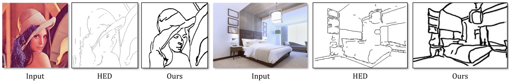
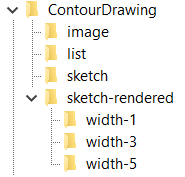

# Form & Folio — AI Drawing Guide

<p align="center">
  
</p>

<p align="center">
  <strong>Turn an image into a progressive drawing reference using the pretrained contour model.</strong>
</p>

Form & Folio wraps this repository's pretrained Pix2Pix contour generator in a local image-upload workspace. Upload a JPG, JPEG, PNG, or WebP image, generate line art, compare it with the reference, explore four drawing stages, and download the selected stage as a PNG.

# Setting up

The code is now updated to use PyTorch 0.4 and runs on Windows, Mac and Linux. For the obsolete version with PyTorch 0.3 (Linux only), please check out the branch [pytorch-0.3-obsolete](../../tree/pytorch-0.3-obsolete).

Windows users should find the corresponding `.cmd` files instead of `.sh` files mentioned below.

## One-line installation (with Conda environments)
`conda env create -f environment.yml`

Then activate the environment (sketch) and you are ready to go!

See [here](https://conda.io/docs/user-guide/tasks/manage-environments.html) for more information about conda environments.

## Manual installation
See `environment.yml` for a list of dependencies.

## Run the local drawing guide

From the project root, start the local web app:

```bash
python server.py
```

Open [http://127.0.0.1:8010](http://127.0.0.1:8010) in a browser. The server uses the existing `models.create_model` Pix2Pix implementation and the checkpoint in `checkpoints/pretrained/latest_net_G.pth`. Keep the server running while using the page; inference runs locally on the server machine. Pass `--port` to choose a different port.

Upload an image, choose **Generate Drawing Guide**, then select a stage, compare it with the source, and download the current stage. The application accepts JPG, JPEG, PNG, and WebP files up to 20 MB.

The four steps use the project's real generated line art. Construction guides are proportion/grid lines based on the generated linework bounds, the contour stage traces boundaries in the generated linework, and the detail/final stages show the model output and its clean black-and-white rendering. This model does not identify semantic parts of an image or produce separate learned stages.

# Using the pre-trained model

- Download the [pre-trained model](https://drive.google.com/file/d/1TQf-LyS8rRDDapdcTnEgWzYJllPgiXdj/view) and extract it into `checkpoints/pretrained/` if the included checkpoint is not present.
- Modify the paths in `scripts/test_pretrained.sh` if needed.
- From the repo's **root directory**, run `scripts/test_pretrained.sh`

It supports a folder of images as input.

# Train & test on our contour drawing dataset

- Download the images and the rendered sketch from the [project page](http://www.cs.cmu.edu/~mengtial/proj/sketch/)
- Unzip and organize them into the following structure:
<p align="center"></p>

- Modify the path in `scripts/train.sh` and `scripts/test.sh`
- From the repo's **root directory**, run `scripts/train.sh` to train the model
- From the repo's **root directory**, run `scripts/test.sh` to test on the val set or the test set (specified by the phase flag)

## Citation
If you use the code or the data for your research, please cite the paper:

```
@article{LIPS2019,
  title={Photo-Sketching: Inferring Contour Drawings from Images},
  author={Li, Mengtian and Lin, Zhe and M\v ech, Radom\'ir and and Yumer, Ersin and Ramanan, Deva},
  journal={WACV},
  year={2019}
}
```

## Acknowledgement
This code is based on an old version of [pix2pix](https://github.com/junyanz/pytorch-CycleGAN-and-pix2pix/).
